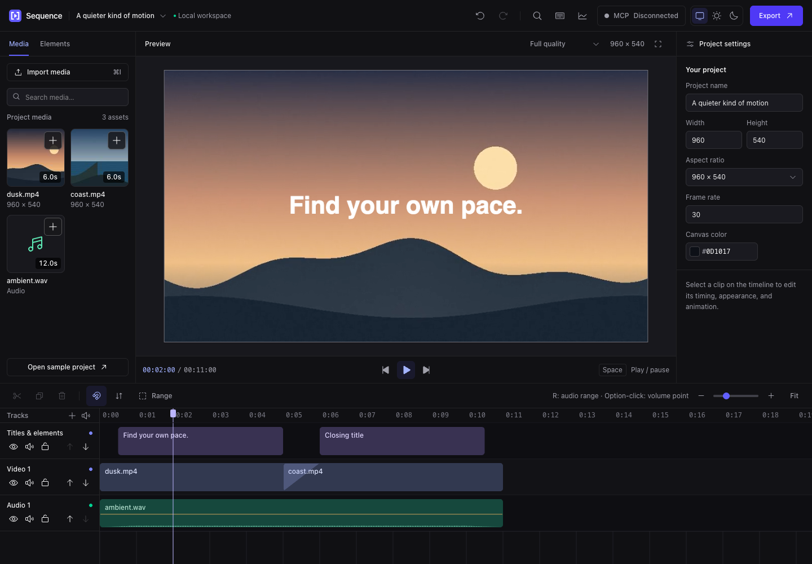

# Sequence

A browser video editor for you and your AI agent. Edit by hand or let
**Claude Code, Codex, Cursor, and other MCP-compatible agents** work on your
timeline through the built-in **MCP server**. Preview and render on your device.

**[Open Sequence](https://alamkanak.github.io/sequence/)** · **[MCP documentation](https://alamkanak.github.io/sequence/docs/mcp/)** · **[Set up AI editing](#ai-editing-with-mcp)**



## What you can do

- Ask Claude Code or Codex to edit your project through MCP.
- Import video, audio, and images by browsing, dropping files, or pasting from the clipboard.
- Trim, split, change speed, and adjust audio with volume points.
- Add text, shapes, gradients, animations, and transitions.
- Preview your edits and export MP4 or WebM on your device.

Includes resizable panels, snapping, undo/redo, and light/dark themes.

Press **⌘K / Ctrl+K** to search actions, navigate to media or segments, and jump
to settings for your selection. **⌘I / Ctrl+I** opens import options; **⌘V / Ctrl+V**
pastes media or a copied timeline segment. Clipboard support depends on the browser;
if the Paste button cannot read it, use the keyboard shortcut or browse files.

## AI editing with MCP

Connect **Claude Code, Codex, Cursor**, or another local MCP client to Sequence.
Ask for edits in plain language, then review them in the timeline.

> “Trim the opening, add a title, and fade the music out.”

No clone or build needed. Install [Node.js 24+](https://nodejs.org/), then add this
local server to your AI app's MCP settings (Claude Desktop/Cursor format):

```json
{
  "mcpServers": {
    "sequence": {
      "command": "npx",
      "args": ["--yes", "https://alamkanak.github.io/sequence/mcp/sequence-mcp-0.1.0.tgz"]
    }
  }
}
```

Restart or refresh your AI app's MCP connection. Ask your agent to **connect to
Sequence**. It calls `connect_editor` and gives you a link to the GitHub Pages
editor. Open it, approve **Connect AI agent**, and allow local network access if
prompted. Keep that tab open while the agent edits.

The companion runs locally; editing and rendering stay in your browser. Your
agent receives project data and any previews it requests. Requires an AI app
with local MCP support. [Setup, typed tool reference, and examples](https://alamkanak.github.io/sequence/docs/mcp/).

## Your files stay local

Media and the current project autosave in your browser. Nothing is uploaded.
Clearing site data removes these copies. Saved project JSON does not include media;
keep the original files to reopen projects on another browser or device.

If media goes missing, click **Relink files…** in the Media panel and select the
original files together. Sequence matches their names and sizes. For a renamed
file, click **Relink file** on its missing asset and choose its new location.
Your timeline edits stay in place, and relinked media is saved in this browser.

Use desktop Chrome or Edge for the best support. Codec support depends on your
browser and device. Exports are currently SDR; HDR preservation is not supported.

## Run locally

Requires Node.js 24 or newer.

```sh
git clone https://github.com/alamkanak/sequence.git
cd sequence
npm ci
npm run dev
```

The same development server serves the [MCP docs](http://127.0.0.1:5173/docs/mcp/)
at `/docs/mcp/`. Changes to tool schemas and descriptions update the reference
automatically. No companion process or connected editor is needed to view docs.

## Deploy to GitHub Pages

In **Settings → Pages**, select **GitHub Actions** as the source.
Push to `main` or run the included **Deploy to GitHub Pages** workflow.

The site will be at **https://alamkanak.github.io/sequence/**.

## Development

Built with React, TypeScript, Tailwind CSS, Phosphor icons, and browser media APIs.

```sh
npm run check
npm test
npm run build
```

Tool contracts live in `companion/contracts.ts`. Strict runtime schemas infer the
TypeScript parameter types and supply the descriptions seen by MCP clients and
the docs site. Define descriptions on every parameter and keep examples valid;
the build checks both. `npm run build` publishes the editor, docs, downloadable
tool schemas, and companion package together. CI checks that the packaged
server's `tools/list` matches the generated reference.

To test MCP locally, keep `npm run dev` running and replace the published-package
configuration with your checkout's companion (Codex TOML; substitute your absolute
repository path):

```toml
[mcp_servers.sequence]
command = "node"
args = [
  "/absolute/path/to/sequence/companion/server.mjs",
  "--editor-url",
  "http://127.0.0.1:5173/"
]
```

Restart your MCP client, ask the agent to call `connect_editor`, then open its
pairing link in Chrome or Edge and approve the connection. Keep that tab open.
The client starts the companion automatically; no build or deployment is needed.
Restart the MCP connection and pair again after changing companion code or tool
schemas. For agent file imports, append `"--allow-media", "/absolute/media/path"`
to `args`.

Performance measurements and benchmark instructions: [BENCHMARK.md](BENCHMARK.md).

## License

Copyright © 2026 Raquib Ul Alam. Licensed under [GNU AGPLv3](LICENSE) (`AGPL-3.0-only`).
